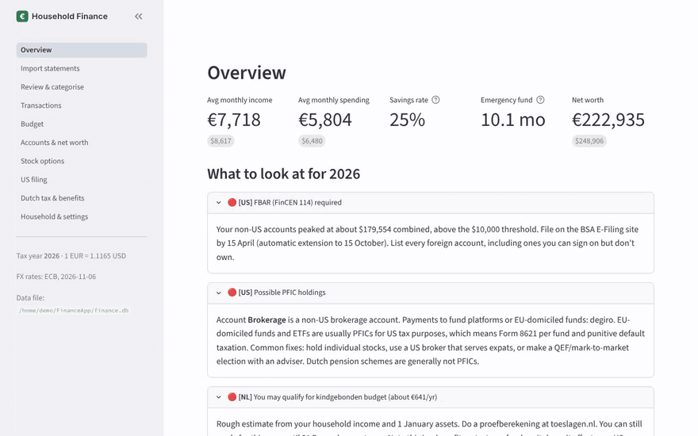
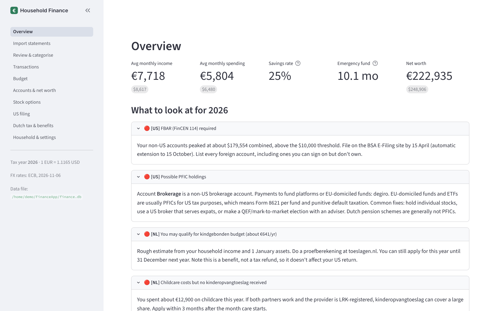
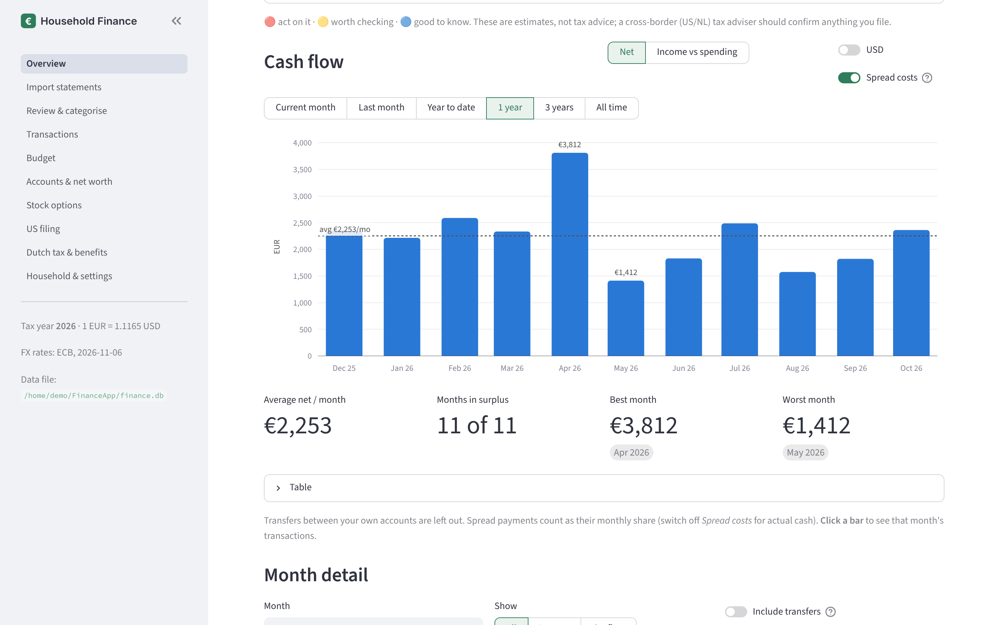
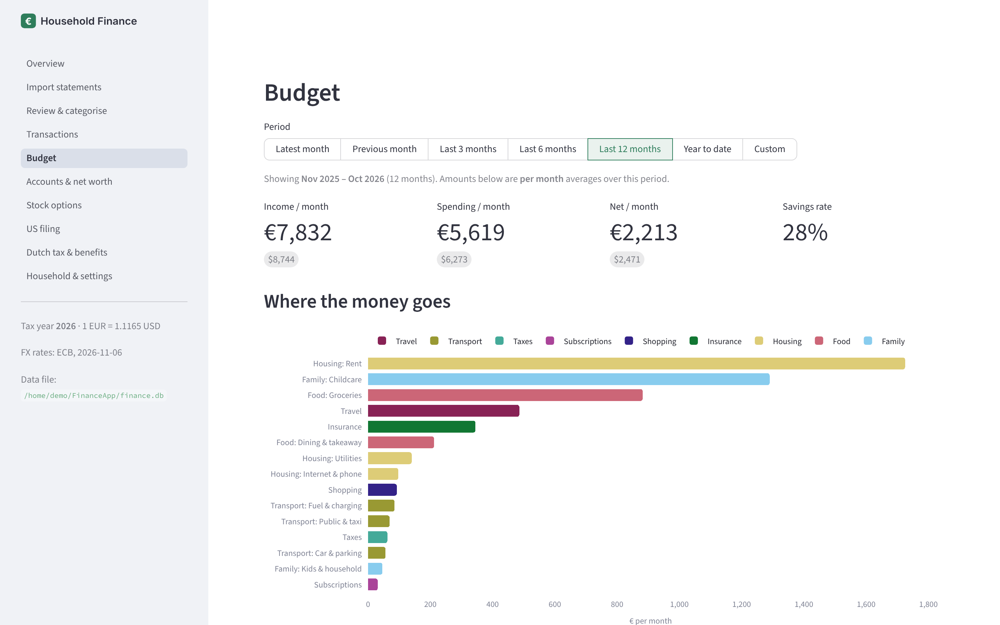
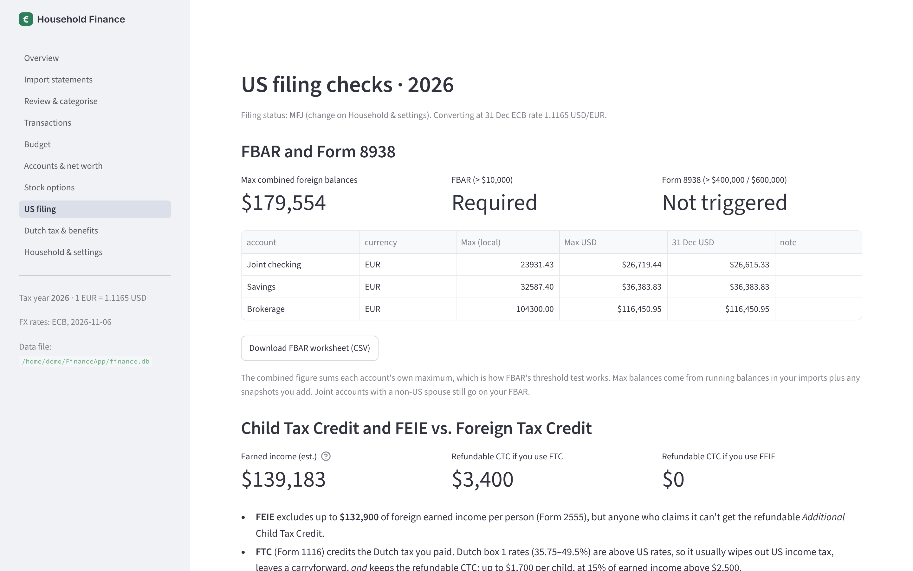
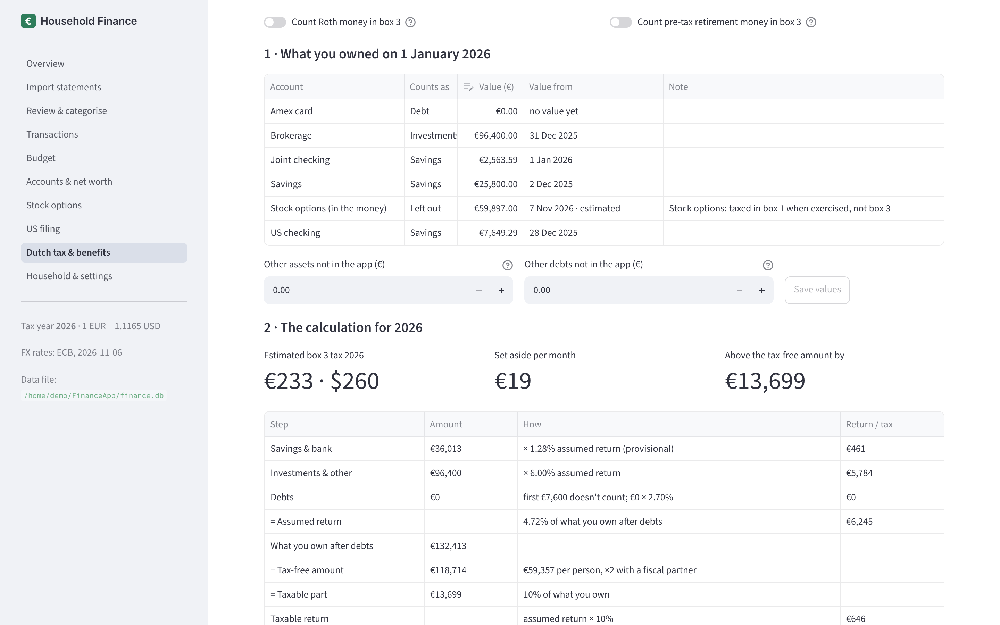
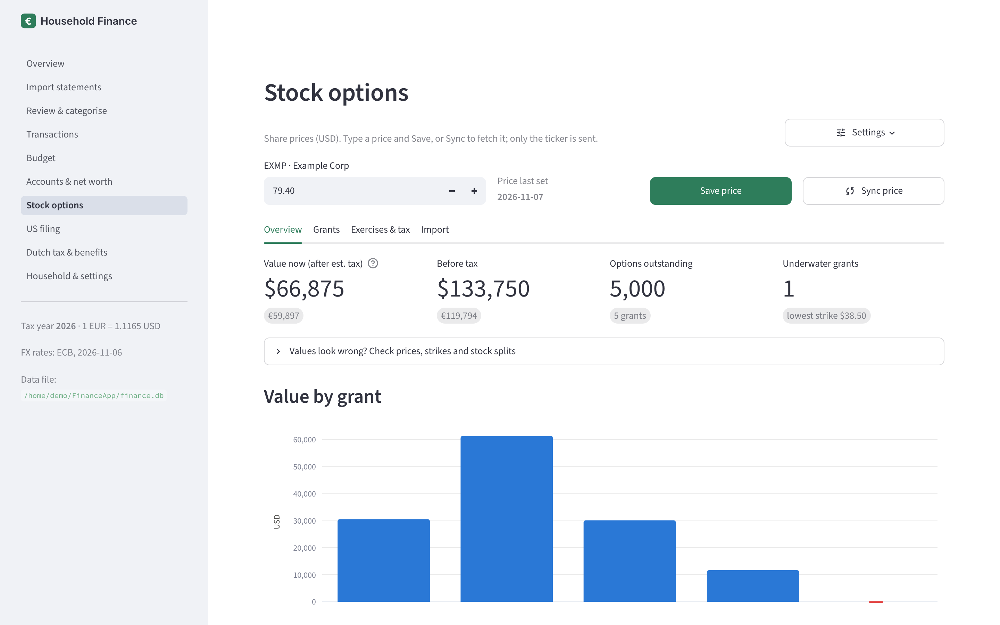

# expat-finance

[](https://github.com/kielpedia/expat-finance/actions/workflows/ci.yml)
[](LICENSE)

**Household Finance** is a private, local app for a US family living in the Netherlands. Import bank statements from both countries, see your budget and net worth in EUR with USD alongside, and get a checklist of US and Dutch tax and benefit items that apply to you.

Everything stays on your computer. The app only goes online when you click for it: to download ECB exchange rates, to fetch a share price for your stock options (only the ticker is sent), if you opt in, to sync EU bank accounts through Enable Banking, or to ask Claude to suggest categories (see below).



<sub>All screenshots use the made-up household in `sample_data/`.</sub>

| | |
|---|---|
|  |  |
| **Overview:** averages, net worth and what to act on this year | **Cash flow:** net per month for any period, click a month for its transactions |
|  |  |
| **Budget:** where the money goes, against your own history and Dutch households | **US filing:** FBAR and Form 8938 thresholds, Child Tax Credit with FTC vs. FEIE |
|  |  |
| **Box 3:** what you owned on 1 January and the tax on it, step by step | **Stock options:** value per grant, splits handled, several companies at once |

## Start it

You need Python 3.11 or newer.

- **macOS / Linux:** double-click or run `./run.sh`
- **Windows:** double-click `run.bat`

The first start creates a virtual environment and installs the packages in `requirements.txt` (Streamlit, pandas, Plotly, requests, openpyxl, pypdf, keyring, defusedxml, cryptography). After that it opens at http://localhost:8501, reachable only from your machine.

**Don't expose it to a network.** The app has no login: anyone who can reach it sees all your data. It refuses to open when it's listening on a network address or reached through a reverse proxy. To use it from other devices, run it in self-hosted mode behind a login instead (see [Self-hosting](#self-hosting-optional)). See [SECURITY.md](SECURITY.md).

## First-time setup

1. **Household & settings:** where you live, filing status, salaries, children (with dates of birth and whether they have an SSN), expat ruling. Then click **Download / refresh ECB rates**.
2. **Import statements:** drop in CSV exports. The format is detected automatically; pick or create the account to import into.
3. **Accounts & net worth:** set each account's type and the bank's country. Add balance snapshots for brokerage, 401(k)/IRA, pension, mortgage and loans.
4. **Transactions:** fix any categories. Hand-edited categories are kept, and you can add rules so future imports sort themselves.

## Supported imports

| Source | Format |
|---|---|
| ING | CSV (comma or semicolon) |
| Rabobank | CSV |
| ABN AMRO | TXT (tab-separated) |
| bunq | CSV |
| Wise | CSV, one per currency balance |
| American Express | CSV |
| Chase, BofA, Citi, Capital One, Schwab, Fidelity and most others | CSV, columns auto-mapped with a manual mapper as backup |

Re-importing overlapping periods is safe: duplicates are skipped.

Try it with fake data: `python sample_data/make_samples.py`, then import the four CSVs in `sample_data/`.

## What it checks

**Budget & health:** monthly cash flow, spending by category, budget targets, recurring payments, savings rate, emergency-fund months, net worth over time, currency exposure.

**US:** FBAR and Form 8938 thresholds from each foreign account's maximum balance, refundable Child Tax Credit under FTC vs. FEIE, missing SSNs, PFIC exposure (EU funds/ETFs), expat-ruling allowance being US-taxable.

**Netherlands:** Box 3 estimate from 1 January balances, kinderbijslag expected vs. received, kindgebonden budget estimate, childcare costs without kinderopvangtoeslag, expat-ruling salary norm and the 2027 change to 27%, and your municipality's charges (waste, sewer, OZB) against what you paid. Utrecht's tariffs are built in; for another municipality, enter the rates from your assessment, or add a block to `MUNICIPAL_CHARGES` in `finapp/benchmarks.py`.

**Payslips:** read Dutch and English payslip PDFs (Workday layout in mind) locally, to check gross, wage tax and expat-ruling allowance against what arrived in your account.

**Stock options:** import your grant history (E*TRADE's Excel export or any CSV); the ticker and company are read from the file, and grants from several companies sit side by side. Values each grant at today's price, handles stock splits (a list of recent large splits is built in, and you can add your own), and records exercises for the tax year.

## Spreading yearly costs

A payment that covers several months (a yearly school fee, annual insurance, an energy settlement) can be set to **Spread** over N months on the Transactions page, the Budget category panel or the Overview month detail. *Next N months* starts in the month it was paid; *Past N months* ends in it. The Budget then counts an equal share each month, and the "Spread payments" box shows the total to set aside per month. Balances and net worth always use the real payment, and the Overview cash-flow chart has a *Spread costs* switch to see actual cash instead.

## What if…

At the bottom of the Budget page you can try changes against your average month: remove or change an income source (per payer), cut or drop a spending category or a single payee, or add a new income or expense. It shows the new monthly net, savings rate, emergency-fund months (or how long savings last if you'd run a shortfall) and a step-by-step chart. Your scenario is kept until you clear it; your data isn't changed.

## EU bank sync (optional)

Instead of exporting CSVs, the **Import statements** page can fetch transactions and balances from EU banks directly, through [Enable Banking](https://enablebanking.com) (PSD2 open banking, read-only). You approve access on your bank's own site; the app never sees your bank login. Nothing is fetched until you click **Sync now**.

1. Create a free account at Enable Banking and register a **Production** application in its Control Panel. As redirect URL, add this app's Import page as your browser reaches it: `http://localhost:8501/import` on a desktop, or e.g. `https://finance.example.org/import` self-hosted. Your browser downloads the app's private key as `<app id>.pem`.
2. In the Control Panel choose **Activate by linking accounts** and link every account you want to sync. In this free, restricted mode only linked accounts are shared, and it's meant for your own, non-commercial use.
3. Put the key where the app looks for it: `~/FinanceApp/enablebanking.pem` (or set `FINAPP_EB_KEY_FILE`), readable only by you. Self-hosted, mount it as a secret (below). The key is never stored in the database or in backups.
4. On **Import statements → Bank connections**, enter the application ID (self-hosted: `FINAPP_EB_APP_ID`), click **Connect a bank**, approve at your bank, and choose which of your accounts each bank account fills.
5. Click **Sync now** whenever you want new transactions.

Each account syncs from the day after the last transaction you already have in it, so CSV history isn't counted twice; synced rows are matched on the bank's own reference, so syncing again adds nothing twice. Only booked transactions are imported. A bank approval lasts up to 180 days for most banks; the page warns two weeks before it ends, and **Renew** keeps your account choices. Banks allow about four updates a day when you're not logged in at the bank, which is plenty for clicking **Sync now**.

## Claude category suggestions (optional)

On **Review & categorise**, *Suggest categories with Claude* sends the payees that still need a category to the Claude API and brings back suggestions for you to accept or change. You need your own API key from console.anthropic.com. Enter it on Household & settings: it's kept in your operating system's credential store (Windows Credential Manager, macOS Keychain or the Linux keyring), never in the database. Or set the `ANTHROPIC_API_KEY` environment variable.

Only cleaned payee names, money in or out, and your category names are sent. Numbers, dates, card references, IBANs and e-mail addresses are removed first; amounts are off unless you switch them on. Payees that look like a person's name are unticked by default. You see the exact request before sending, and every request is logged under Household & settings.

## Keeping it current

All tax figures live in `finapp/rules.py`, one block per year, with sources. Add a new year's block each January. Some 2026 figures are provisional (Box 3 savings/debt rates) or only from secondary sources (kindgebonden budget age supplements); they're marked `verify`.

## Your data

One SQLite file at `~/FinanceApp/finance.db` (set `FINAPP_DB` to move it; self-hosted, it's in the `/data` volume). It's not encrypted, so keep it on an encrypted disk (FileVault/BitLocker) and back it up from the Settings page.

## Self-hosting (optional)

Desktop mode is the default and the simplest. If you'd rather run the app on a home server and open it from any device, there's a container image for that. It only works behind a reverse proxy that does the login, because the app has none of its own.

How it stays safe:

- The image starts in self-hosted mode (`FINAPP_MODE=server`) and refuses to show anything until you set `FINAPP_PROXY_SECRET` (32+ random characters).
- Your reverse proxy asks for a password, then adds that secret to every request in the `X-Finapp-Proxy-Secret` header. The app refuses any request without it, so going to the server's port directly skips nothing.
- Keep it on your home network or VPN; don't publish it to the internet.

Run it with Docker Compose:

```yaml
services:
  finapp:
    image: ghcr.io/kielpedia/expat-finance:main    # or pin a commit SHA tag
    restart: unless-stopped
    ports:
      - "8501:8501"
    environment:
      FINAPP_PROXY_SECRET: "<output of: openssl rand -hex 32>"
      TZ: Europe/Amsterdam
      # ANTHROPIC_API_KEY: "sk-ant-..."             # optional, for Claude category suggestions
      # FINAPP_EB_APP_ID: "<application id>"        # optional, for EU bank sync
      # FINAPP_EB_REDIRECT_URL: "https://finance.example.org/import"
    volumes:
      - finapp-data:/data                           # the database lives here
    # secrets: [enablebanking.pem]                  # optional, for EU bank sync
volumes:
  finapp-data:
# secrets:
#   enablebanking.pem:
#     file: ./enablebanking.pem                     # chown 10001 and chmod 400 on the host: the container runs as uid 10001
```

And a Caddy site in front of it (create the password hash with `caddy hash-password`):

```
finance.example.org {
	@outside not remote_ip 192.168.0.0/16 10.0.0.0/8
	abort @outside
	basic_auth {
		you <password hash>
	}
	reverse_proxy <server-ip>:8501 {
		header_up X-Finapp-Proxy-Secret {env.FINAPP_PROXY_SECRET}
	}
}
```

Set `FINAPP_PROXY_SECRET` in Caddy's environment to the same value. To move an existing database, upload your `finance.db` under Settings → Restore from a backup. On a server there's no credential store, so set `ANTHROPIC_API_KEY` in the container's environment if you use Claude suggestions. The data is still unencrypted on the server's disk and in its backups. For EU bank sync, the key is read from `/run/secrets/enablebanking.pem`; the bank's approval page sends your browser back to `FINAPP_EB_REDIRECT_URL`, so it only needs to be reachable from your browser (your home network), not from the internet.

## Not tax advice

The app estimates and flags. A cross-border US/NL tax adviser should confirm anything you file.

## Development

```
python -m venv .venv && .venv/bin/pip install -r requirements-dev.txt   # Windows: .venv\Scripts\pip
.venv/bin/pytest            # tests
.venv/bin/ruff check .      # lint
```

Tests use the fake data in `sample_data/` and never touch your own database. See [CONTRIBUTING.md](CONTRIBUTING.md) for adding a bank format or a new tax year.

## License

[MIT](LICENSE)
